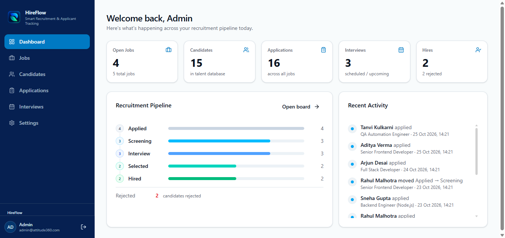
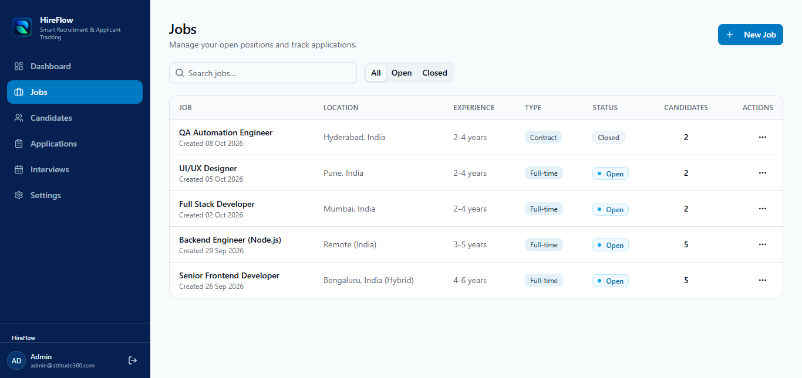
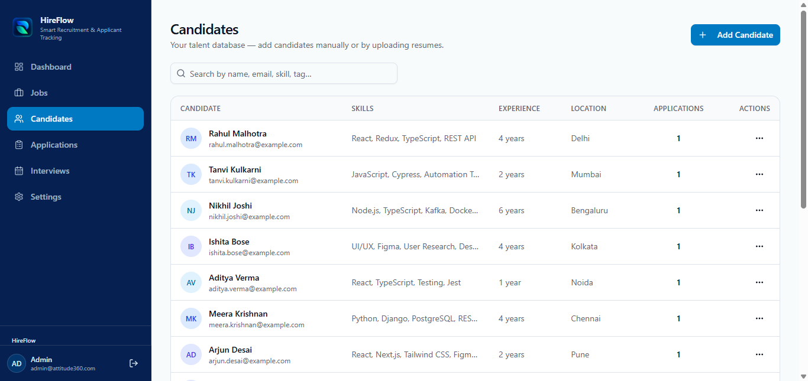
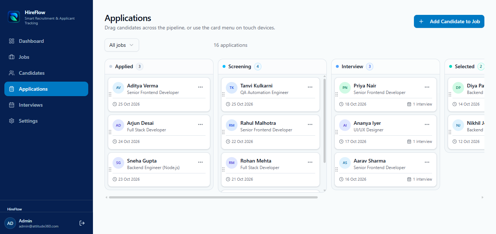
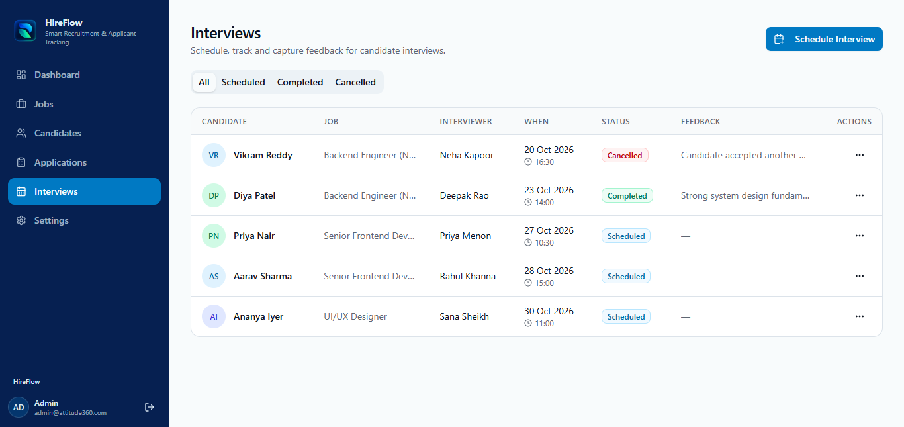
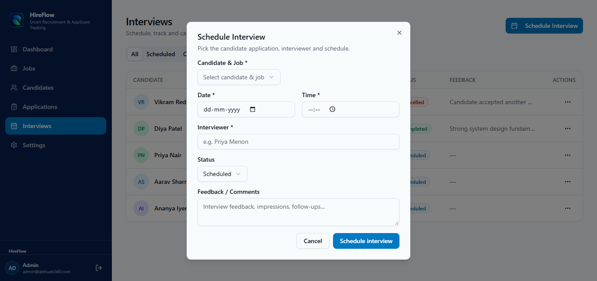
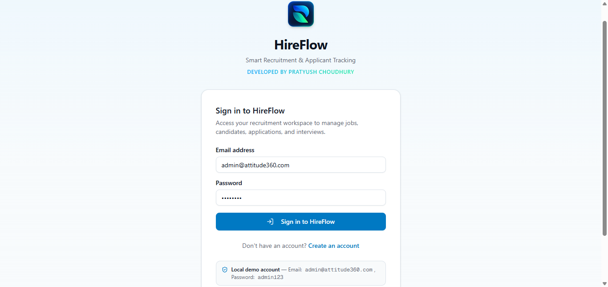
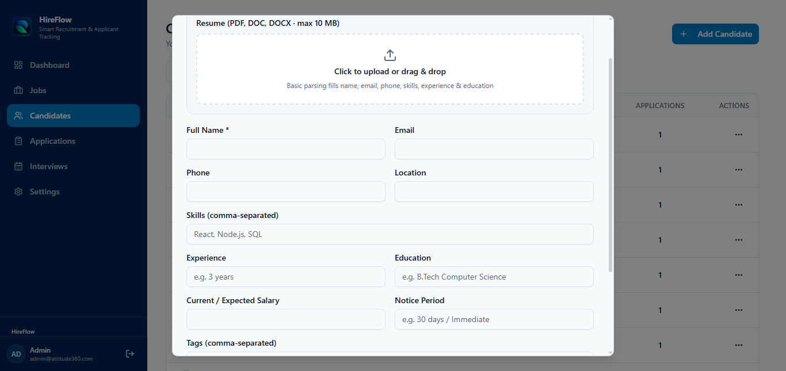

# HireFlow — Recruitment & Applicant Tracking System

<p align="center">
  <strong>Smart Recruitment & Applicant Tracking</strong>
  <br />
  A centralized platform for managing jobs, candidates, applications, and interviews.
</p>

<p align="center">
  <a href="https://hireflow-phi-five.vercel.app/">
    
  </a>
  <a href="https://github.com/pratyush-choudhury-11/HireFlow">
    
  </a>
</p>

---

## 📌 About the Project

**HireFlow** is a full-stack recruitment management and Applicant Tracking System (ATS) designed to help recruiters organize their hiring workflows from a single dashboard.

Recruitment involves managing job openings, maintaining candidate records, tracking applications, scheduling interviews, and monitoring hiring progress. HireFlow brings these workflows together in one web application.

The project demonstrates practical full-stack development, API design, database integration, authentication, and deployment using modern web technologies.

### 🎯 Project Goals

- Centralize recruitment information.
- Simplify candidate and job management.
- Track applications through recruitment stages.
- Organize interview scheduling and feedback.
- Provide a dashboard for monitoring recruitment activity.

## 🌐 Live Application

**[Launch HireFlow](https://hireflow-phi-five.vercel.app/)**

**[Explore the source code on GitHub](https://github.com/pratyush-choudhury-11/HireFlow)**

The live demo demonstrates the deployed application. Available functionality depends on the current production configuration.

---

## ✨ Key Features

### 📊 Recruitment Dashboard

- Overview of jobs, candidates, applications, and interviews.
- Recruitment pipeline visualization.
- Recent recruitment activity.
- Centralized recruitment statistics.

### 💼 Job Management

- View and manage job openings.
- Display job titles, locations, and employment types.
- Track open and closed positions.
- View job-related application information.

### 👥 Candidate Management

- Maintain candidate profiles.
- Store candidate contact and professional information.
- Track skills and experience.
- Upload candidate resumes.
- Review candidate-related application information.

### 📋 Application Tracking

- Organize applications by recruitment stage.
- Track candidate progress through the hiring pipeline.
- Associate applications with job openings.
- Monitor the recruitment process.

### 📅 Interview Management

- Schedule candidate interviews.
- Record interviewer information.
- Track interview status.
- Store interview feedback and comments.

### 📄 Resume Processing

- Provide a resume upload workflow.
- Support resume-related API operations.
- Include a resume parsing endpoint.

Actual parsing capabilities depend on the implementation and production configuration.

### 🔐 Authentication & Account Settings

- User registration and login.
- Account profile management.
- Password change functionality.
- Authentication-related API endpoints.

---

## 🖥️ Application Screenshots

Screenshots below are loaded from the repository's `screenshots` folder.

> Ensure each filename matches the actual image in your repository. GitHub renders relative image paths in README files.

### 1. Recruitment Dashboard

View recruitment statistics, pipeline progress, and recent activity.



### 2. Job Management

Manage job openings, employment types, locations, and job status.



### 3. Candidate Management

View candidate profiles, professional skills, experience, and application information.



### 4. Application Tracking

Organize applications and monitor candidate progress through recruitment stages.



### 5. Interview Management

Review scheduled interviews, interviewers, statuses, and feedback.



### 6. Schedule an Interview

Schedule interviews for candidates and associate them with relevant job openings.



### 7. Login Interface

Access the recruitment workspace through the login page.



### 8. Resume Upload

Upload candidate resumes through the candidate management interface.



---

## 🛠️ Technology Stack

| Category | Technology |
|---|---|
| Frontend | Next.js, React, TypeScript |
| Routing | Next.js App Router |
| Backend | Next.js API Routes |
| Styling | Tailwind CSS |
| UI Icons | Lucide React |
| Notifications | Sonner |
| ORM | Prisma |
| Database | SQLite in local development; production database depends on deployment configuration |
| Package Manager | npm |
| Version Control | Git and GitHub |
| Deployment | Vercel |

---

## 🏗️ System Architecture

HireFlow separates the user interface, API endpoints, and database access into distinct application layers.

```text
┌────────────────────────────────────┐
│             User                   │
└─────────────────┬──────────────────┘
                  │
                  ▼
┌────────────────────────────────────┐
│        Next.js Frontend            │
│        React + TypeScript          │
└─────────────────┬──────────────────┘
                  │
                  ▼
┌────────────────────────────────────┐
│        Next.js API Routes           │
│                                    │
│  Authentication                    │
│  Jobs                               │
│  Candidates                         │
│  Applications                       │
│  Interviews                         │
│  Dashboard                          │
│  Resume Operations                  │
└─────────────────┬──────────────────┘
                  │
                  ▼
┌────────────────────────────────────┐
│             Prisma ORM              │
└─────────────────┬──────────────────┘
                  │
                  ▼
┌────────────────────────────────────┐
│             Database                │
└────────────────────────────────────┘
```

---

## 📂 Project Structure

```text
HireFlow/
├── public/                     # Public assets and branding
├── prisma/                     # Prisma schema and database configuration
├── screenshots/                # Application screenshots
├── src/
│   ├── app/
│   │   ├── api/
│   │   │   ├── applications/   # Application endpoints
│   │   │   ├── auth/           # Authentication endpoints
│   │   │   ├── candidates/     # Candidate endpoints
│   │   │   ├── dashboard/      # Dashboard statistics
│   │   │   ├── interviews/     # Interview endpoints
│   │   │   ├── jobs/           # Job endpoints
│   │   │   └── resumes/        # Resume endpoints
│   │   ├── layout.tsx          # Root layout
│   │   └── page.tsx            # Main application entry point
│   ├── components/             # Reusable UI and application components
│   └── lib/                    # Shared utilities and client logic
├── .gitignore
├── package.json
├── package-lock.json
└── README.md
```

This is a representative overview of the project structure. The actual repository may contain additional files and directories.

---

## 🔌 API Overview

The project includes API routes for core recruitment workflows.

| Endpoint | Purpose |
|---|---|
| `/api/auth/login` | User login |
| `/api/auth/register` | User registration |
| `/api/auth/logout` | User logout |
| `/api/auth/me` | Current-user information |
| `/api/auth/password` | Password operations |
| `/api/jobs` | Job management |
| `/api/candidates` | Candidate management |
| `/api/applications` | Application tracking |
| `/api/interviews` | Interview management |
| `/api/dashboard` | Dashboard statistics |
| `/api/resumes` | Resume-related operations |
| `/api/candidates/parse-resume` | Resume parsing |

Individual record endpoints are also available for supported resources.

The exact HTTP methods and operations depend on the implementation of each route.

---

## 💻 Getting Started

Follow these instructions to run HireFlow locally.

### Prerequisites

- Node.js compatible with the project dependencies.
- npm.
- Git.

### 1. Clone the repository

```bash
git clone https://github.com/pratyush-choudhury-11/HireFlow.git
cd HireFlow
```

### 2. Install dependencies

```bash
npm install
```

### 3. Configure environment variables

Create a `.env` file in the project root.

Configure the database connection and any other required environment variables.

Example:

```env
DATABASE_URL="YOUR_DATABASE_CONNECTION_STRING"
```

Replace the placeholder with the connection string appropriate for your Prisma datasource.

**Never commit production credentials, secrets, or private database backups to GitHub.**

### 4. Generate Prisma Client

```bash
npx prisma generate
```

### 5. Initialize the database

Follow the database setup and migration workflow configured in the project's Prisma schema.

For local development, use the appropriate SQLite database configuration if that is what your schema specifies.

For production, configure a persistent database and apply the required migrations safely. Back up existing data before making schema changes.

### 6. Run the development server

```bash
npm run dev
```

Open the application at:

```text
http://localhost:3000
```

### 7. Build for production

```bash
npm run build
```

---

## 🔒 Security and Data Management

Recruitment applications may contain sensitive candidate information. Follow these practices:

- Keep `.env` files and secrets out of version control.
- Do not publish private candidate information or real resumes.
- Use fictional candidate records for demonstrations.
- Protect authentication and candidate-management endpoints.
- Verify authorization checks for sensitive operations.
- Use persistent storage for production database records.
- Configure resume storage and access controls securely.
- Back up production data before database migrations.

---

## 📚 Skills Demonstrated

This project demonstrates practical experience with:

- Full-stack web application development.
- Next.js and React component development.
- TypeScript.
- API route implementation.
- Prisma ORM and database integration.
- Authentication and account management.
- CRUD operations and data modeling.
- Recruitment workflow design.
- Form handling and user interaction.
- Git, GitHub, and Vercel deployment.

---

## 🔮 Future Improvements

Potential future enhancements include:

- Role-based access control.
- Advanced recruitment analytics.
- Email notifications and interview reminders.
- Improved candidate search and filtering.
- Additional resume parsing capabilities.
- Recruitment reports and exports.
- Automated testing and continuous integration.
- Enhanced audit logging and security controls.

---

## 📄 License

See the repository's `LICENSE` file for the applicable licensing terms and copyright information.

---

<p align="center">
  <strong>HireFlow</strong>
  <br />
  Smart Recruitment & Applicant Tracking
  <br /><br />
  <a href="https://hireflow-phi-five.vercel.app/">Live Demo</a>
  &nbsp; • &nbsp;
  <a href="https://github.com/pratyush-choudhury-11/HireFlow">GitHub Repository</a>
</p>
